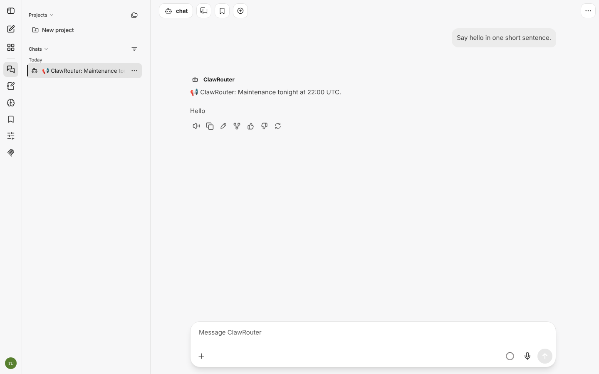

# LibreChat with ClawRouter

[LibreChat](https://github.com/danny-avila/LibreChat) is a multi-user chat application.
ClawRouter is added to it as a **custom endpoint**: LibreChat's users chat, and ClawRouter
does the routing, failover, limits, quotas, usage tracking and audit.

**Tested** on 2026-11-18 with LibreChat **v0.8.9** (configuration version 1.3.19) and
ClawRouter `main`. See [What was tested](#what-was-tested).

## 1. Create an API key for LibreChat

In the ClawRouter console, open **Gateway → My API keys** (or **API Access** to create a key
for an application) and create a key:

- **Name:** `librechat`, so its requests are easy to find under Requests and Usage.
- **Allowed models:** the aliases and models LibreChat may offer. Leave it empty for all.
- **Notices in replies:** leave it on if your users should see ClawRouter's announcements
  and health notices in the chat (see [step 4](#4-announcements-and-notices)).

Copy the key (`crk_…`). It is shown only once.

Every LibreChat user shares this one key, so ClawRouter's per-key rate limits and the key
owner's quota apply to all of them together.

## 2. Add ClawRouter to LibreChat

Follow LibreChat's own Docker installation (clone the repository, copy `.env.example` to
`.env`), then add two things.

**`.env`**: the key, so it stays out of the configuration file:

```bash
CLAWROUTER_API_KEY=crk_your_key
```

**`librechat.yaml`**: ClawRouter as a custom endpoint:

```yaml
version: 1.3.19
cache: true
endpoints:
  custom:
    - name: "ClawRouter"
      apiKey: "${CLAWROUTER_API_KEY}"
      baseURL: "http://host.docker.internal:8080/v1"
      models:
        default: ["chat"]   # shown if the model list cannot be fetched
        fetch: true         # list what the key may use, from /v1/models
      titleConvo: true
      titleModel: "current_model"
      modelDisplayLabel: "ClawRouter"
```

- **`baseURL`:** ClawRouter's address followed by `/v1`. On the same machine as LibreChat's
  containers, use `host.docker.internal` (LibreChat's Compose file maps it) and make
  ClawRouter listen on more than loopback (`CLAWROUTER_HOST=0.0.0.0`). On another host,
  use its HTTPS address.
- **`default`:** an alias or model that exists in ClawRouter. With `fetch: true`, LibreChat
  replaces the list with what the key may use.
- To show only ClawRouter in LibreChat's endpoint menu, set `ENDPOINTS=custom` in `.env`.

Mount the file into the API container. LibreChat reads `docker-compose.override.yml`:

```yaml
services:
  api:
    volumes:
      - type: bind
        source: ./librechat.yaml
        target: /app/librechat.yaml
```

Then `docker compose up -d` and open `http://localhost:3080`. The log line
`Custom config file loaded` lists the ClawRouter endpoint when the file was read.

## 3. Chat

Register an account, and pick **ClawRouter** and a model in the menu at the top. An alias
such as `chat` lets ClawRouter choose and fail over. Answers stream.

Every request appears in ClawRouter under **Gateway → Requests** with the key's name, the
model that answered, attempts, tokens and estimated cost. With `titleConvo: true`,
LibreChat makes one more request per new conversation to name it; it counts like any other.

## 4. Announcements and notices

ClawRouter can start replies with a notice line, such as `📢 ClawRouter: Maintenance
tonight at 22:00 UTC.` or a degraded-health warning (see [client notices](../notices.md)).
LibreChat shows them at the start of the reply without any change.

- **Titles:** with an announcement sent on **every request**, the title request gets the line
  too, and conversations are named after the announcement. Prefer **once**, **daily** or
  **weekly** announcements for chat apps (the first request of a conversation is the reply,
  so that is where they appear), or set `titleConvo: false`.
- **History:** LibreChat stores the reply with the notice line. When the conversation is sent
  back, ClawRouter removes its own lines before the provider sees them (the cleanup setting,
  on by default).
- **No notices:** turn off **Notices in replies** on the key.



## Troubleshooting

| Symptom | Cause |
| --- | --- |
| ClawRouter is missing from the endpoint menu | `librechat.yaml` was not mounted, or has a YAML error. Look for `Custom config file loaded` in the API container's log. |
| Only the `default` model is listed | LibreChat could not fetch `/v1/models`: wrong `baseURL`, the key is wrong or revoked, or ClawRouter is not reachable from the container. |
| "Connection refused" on the same machine | The container is calling `127.0.0.1`. Use `host.docker.internal` and make ClawRouter listen on `0.0.0.0`. |
| 429 errors | The key's rate limit or the owner's quota. Raise the key's limit under API Access, or give LibreChat its own key. |
| Conversation titles start with "📢 ClawRouter" | An every-request announcement; see step 4. |

## What was tested

Tested on 2026-11-18 with the `librechat/librechat` image v0.8.9 from Docker Hub and
`mongo:8`, started with `docker run` using the `.env` values and `librechat.yaml` above
(`ENDPOINTS=custom`, `SEARCH=false`). LibreChat's full Compose installation was not run;
it starts the same image with the same file and variables. ClawRouter ran from `main` with
an OpenAI-type provider pointed at the project's mock OpenAI server
(`tests/support/mock-providers.ts`). The chat app only talks to ClawRouter, so the provider
behind it does not change what was tested.

- LibreChat loaded the endpoint and fetched the key's list: `chat`, `openai/gpt-4o`,
  `openai/gpt-4o-mini`. A new chat opened on ClawRouter with `chat`.
- A streamed chat through the alias, recorded in ClawRouter's request history under the key.
- With an every-request announcement, the reply started with
  `📢 ClawRouter: Maintenance tonight at 22:00 UTC.`, and the conversation's title did too
  (the reason for the advice in step 4).
