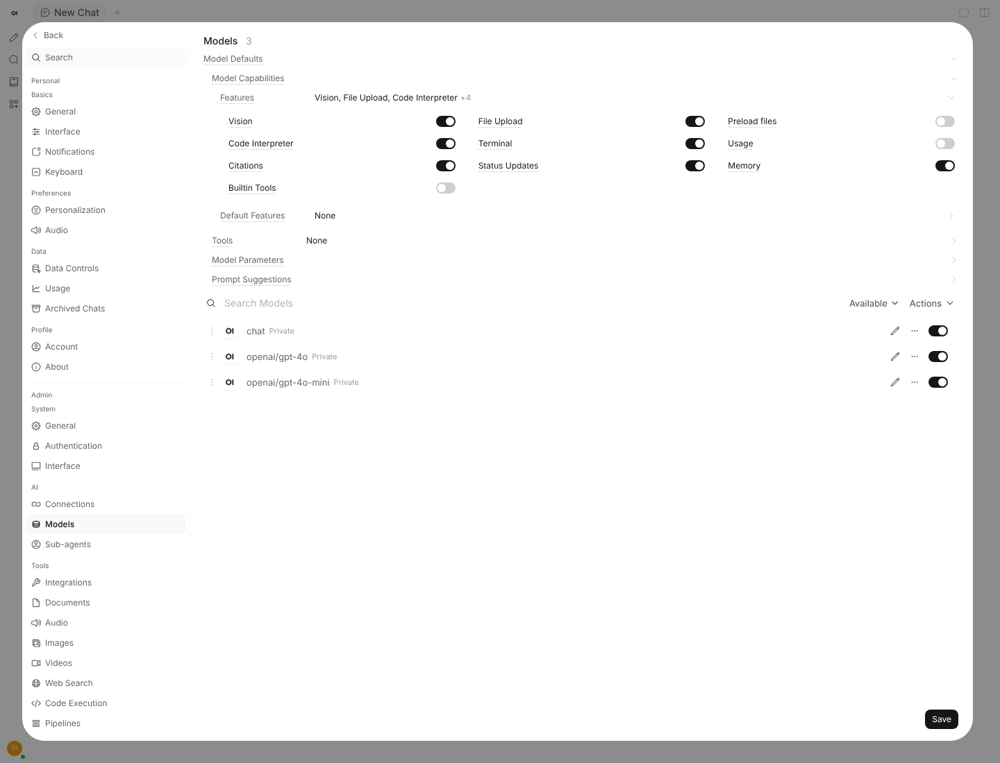
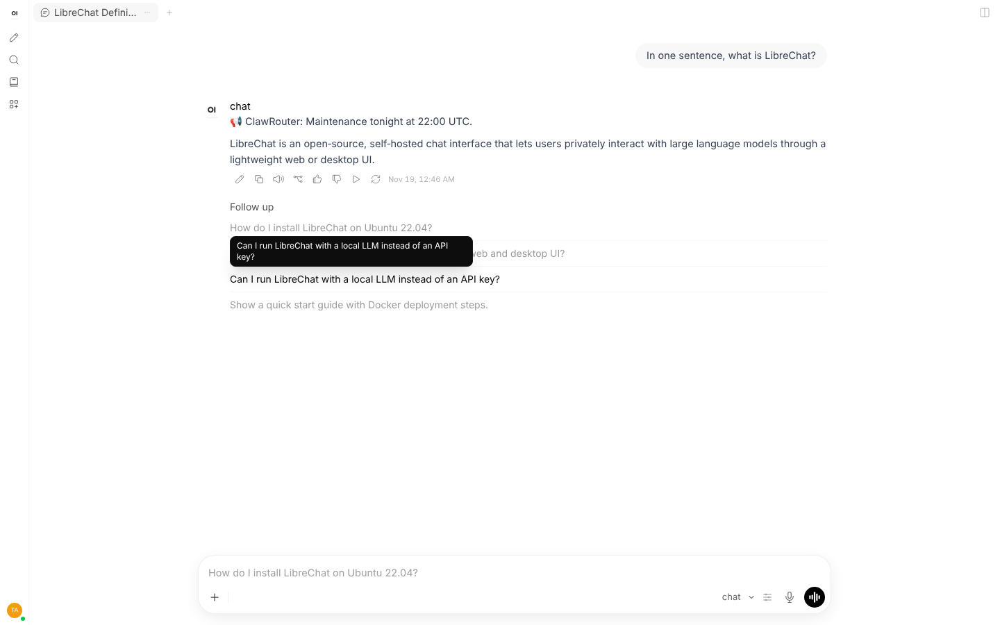
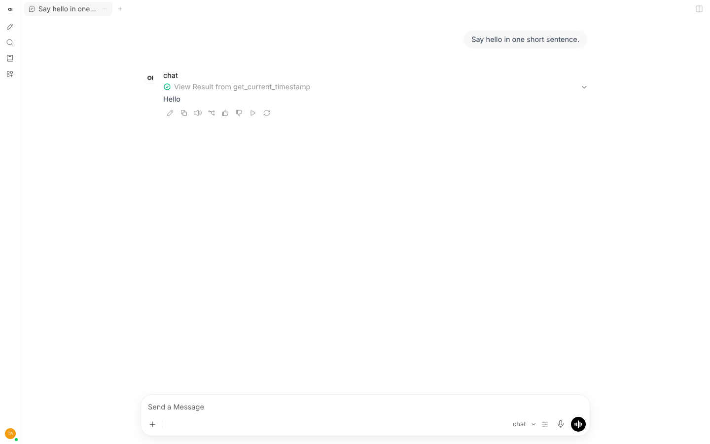
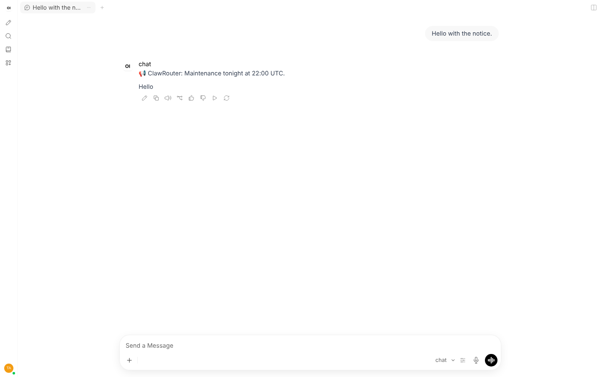

# Open WebUI with ClawRouter

[Open WebUI](https://github.com/open-webui/open-webui) is a self-hosted chat interface. It
talks to any OpenAI-compatible server, so it can use ClawRouter as its only model source:
your users chat in Open WebUI, and ClawRouter does the routing, failover, limits, quotas,
usage tracking and audit.

**Tested** on 2026-11-18 with Open WebUI **0.13.4** and ClawRouter `main`. See [What was
tested](#what-was-tested) for exactly what was checked and how.

## 1. Create an API key for Open WebUI

In the ClawRouter console, open **Gateway → My API keys** (or **API Access** to create a key
for an application) and create a key:

- **Name:** `open-webui`, so its requests are easy to find under Requests and Usage.
- **Allowed models:** the aliases and models Open WebUI may offer. Leave it empty for all.
  Open WebUI lists exactly what the key may use.
- **Notices in replies:** leave it on if your users should see ClawRouter's announcements
  and health notices in the chat (see [step 4](#4-announcements-and-notices)).

Copy the key (`crk_…`). It is shown only once.

Every Open WebUI user shares this one key. ClawRouter's per-key rate limits and the key
owner's quota apply to all of them together. Open WebUI's own users are not ClawRouter users.

## 2. Start Open WebUI pointed at ClawRouter

Open WebUI reads its OpenAI connection from environment variables when it starts for the
first time.

| Variable | Value |
| --- | --- |
| `OPENAI_API_BASE_URL` | ClawRouter's address followed by `/v1`, e.g. `https://ai.example.com/v1` |
| `OPENAI_API_KEY` | The key from step 1 |
| `ENABLE_OLLAMA_API` | `false`, unless you also run Ollama next to it |

With Docker:

```bash
docker run -d --name open-webui -p 3000:8080 \
  --add-host=host.docker.internal:host-gateway \
  -e OPENAI_API_BASE_URL=http://host.docker.internal:8080/v1 \
  -e OPENAI_API_KEY=crk_your_key \
  -e ENABLE_OLLAMA_API=false \
  -v open-webui:/app/backend/data \
  ghcr.io/open-webui/open-webui:main
```

- **ClawRouter on the same machine:** inside the container, `127.0.0.1` is the container
  itself. Use `host.docker.internal` (the `--add-host` line makes it work on Linux) and
  make ClawRouter listen on more than loopback (`CLAWROUTER_HOST=0.0.0.0`, or the address
  of the Docker bridge). ClawRouter's own Compose file already listens on `0.0.0.0`.
- **ClawRouter on another host:** use its public HTTPS address.
- **Without Docker:** `pip install open-webui`, then run
  `OPENAI_API_BASE_URL=… OPENAI_API_KEY=… ENABLE_OLLAMA_API=false open-webui serve`.

Open `http://localhost:3000` and create the first account, which becomes Open WebUI's
administrator.

**Changing the connection later:** after the first start, Open WebUI keeps the connection in
its own database, and the environment variables no longer change it. Edit it under **Admin
Settings → Connections → OpenAI API**.

## 3. Chat

The model menu lists ClawRouter's aliases and models, exactly as `GET /v1/models` returns
them for the key. Pick one (an alias such as `chat` lets ClawRouter choose and fail over)
and send a message. Answers stream.

Every request appears in ClawRouter under **Gateway → Requests** with the key's name, the
model that answered, attempts, tokens and estimated cost.

Open WebUI also makes **background requests** with the same key: a title for each new
chat, tags, and follow-up suggestions. They count towards the key's limits and usage like
any other request. To send them to a cheaper model, set the **External Task Model** under Admin
Settings → Interface.

## 4. Announcements and notices

ClawRouter can start replies with a notice line, such as `📢 ClawRouter: Maintenance
tonight at 22:00 UTC.` or a degraded-health warning (see [client notices](../notices.md)).
In Open WebUI they appear only after one change.

By default Open WebUI offers its **built-in tools** (time, memory and others) to the model
with every chat. ClawRouter never writes text into requests that offer tools, because
clients read tool replies as data. So while built-in tools are on, notices only travel in the
`X-ClawRouter-Notices` header, which Open WebUI does not show.

To see them in the chat, turn built-in tools off: **Admin Settings → Models → Model
Defaults → Model Capabilities → Features → Builtin Tools**, then **Save**.



Things to know:

- **Repeated notices:** with an announcement sent on **every request**, background requests
  (titles, tags) get the line too, so chat titles may start with it. Prefer **once**,
  **daily** or **weekly** announcements for chat apps.
- **Your own users' history:** Open WebUI keeps the notice line in its stored conversation.
  When the conversation is sent back, ClawRouter removes its own lines before the provider
  sees them (the cleanup setting, on by default).
- **No notices in a chat app:** turn off **Notices in replies** on the key.

## Troubleshooting

| Symptom | Cause |
| --- | --- |
| No models in the menu | The key is wrong, revoked or expired; or the key allows no model that is enabled. Check `curl <base>/models -H "Authorization: Bearer <key>"`. |
| "Connection refused" on the same machine | Open WebUI in Docker is calling `127.0.0.1`. Use `host.docker.internal` and make ClawRouter listen on `0.0.0.0`. |
| 429 errors in the chat | The key's rate limit or the owner's quota. Raise the key's limit under API Access, or give Open WebUI its own key. |
| A tool request is refused with "No model … supports tools" | The chosen model is not marked Tool use in ClawRouter. Mark it under Models, or turn off Builtin Tools. |
| Questions that use a tool fail with "rate_limited" or "Request too large" | Built-in tools make each request large (about 4,700 input tokens with the defaults), and answering with a tool takes two of them a second apart. A provider's per-minute token limit (Groq's free tier: 7,000–8,000 per model) is easily passed. Turn off Builtin Tools, use a higher provider tier, or add fallback targets with their own limits to the alias. |
| The environment variables changed nothing | Open WebUI keeps the connection from its first start. Edit it under Admin Settings → Connections. |

## What was tested

Tested on 2026-11-18 with Open WebUI 0.13.4 installed with `pip` (GitHub's container
registry could not be reached from the test machine; the Docker image runs the same
application with the same variables). ClawRouter ran from `main` with an OpenAI-type
provider pointed at the project's mock OpenAI server (`tests/support/mock-providers.ts`). The
chat app only talks to ClawRouter, so the provider behind it does not change what was
tested.

- The model menu showed the `chat` alias and both models the key allowed.
- A streamed chat through the alias, recorded in ClawRouter's request history under the key.
- With built-in tools on: Open WebUI offered its tools, the model called
  `get_current_timestamp`, Open WebUI ran it and sent the result back, and the answer arrived
  (the tool-call round trip through ClawRouter).
- With an every-request announcement: no notice line while built-in tools were on; the line
  `📢 ClawRouter: Maintenance tonight at 22:00 UTC.` at the start of the reply after turning
  them off.

**Live, on 2026-11-19**, the same setup with a Groq provider in ClawRouter (the `chat` alias
on `groq/openai/gpt-oss-20b`, then `groq/qwen/qwen3.8-27b` as a fallback):

- Plain chats answered by Groq, streamed, with Groq-written titles and follow-up suggestions
  (background requests, each recorded in ClawRouter), and the announcement line once built-in
  tools were off.
- With built-in tools on, Groq returned a real tool call (`get_current_timestamp`) and Open
  WebUI ran it, but the follow-up carrying the result failed: Groq answered 429 (tokens per
  minute) for gpt-oss-20b, ClawRouter retried and failed over to Qwen, and Groq refused that as
  too large for the free tier (7,397 input tokens, limit 7,000). See Troubleshooting.




